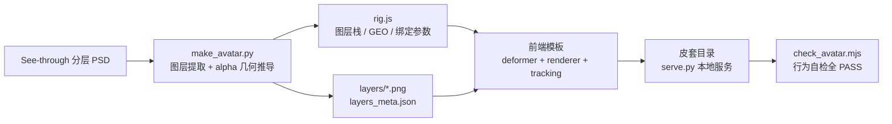

# Live2D Pet · 从分层 PSD 到可直接使用的人脸驱动网页皮套

> 输入一份 **See-through 分层 PSD**，输出一个**本机打开即用**的网页版 Live2D 皮套（摄像头人脸驱动）。不需要 Cubism Editor，不需要 Live2D SDK，不需要联网。

*Turn a See-through layered PSD into a ready-to-use, webcam-driven Live2D-style avatar that runs entirely in your browser — no Cubism Editor, no SDK, no cloud services.*

---

## 它能做什么

- **人脸驱动**：MediaPipe FaceLandmarker 输出 478 个关键点、52 个 blendshape 和 4×4 头部姿态矩阵，分别驱动转头 / 点头 / 歪头、眨眼、注视、口型与眉毛。
- **有体积感的头部动作**：转头带非对称内收（近大远小）和轮廓反推；点头用穹顶位移场（五官领先轮廓），不是整张脸平移。
- **局部动作**：上睫毛几何下落 + 眼白虹膜淡出的闭眼（无需变体图）、随头部 roll 旋转的口型拉伸轴、头发前后摆动、耳坠单摆、躯干圆柱跟随、脖子近刚体不伸缩。
- **直播友好**：导入背景图（或拖图进画面）、一键隐藏界面的直播模式、全屏、把当前画面存成 PNG。
- **生成即自检**：生成器按标准品校准的参数产出皮套，随后由 `check_avatar.mjs` 跑 7 组行为断言，**全部 PASS 才算完成**。
- **完全本地**：模型（`.task` + WASM）和控制逻辑都在仓库内，摄像头画面不上传。

## 工作流程



生成器从图层的 alpha 通道反推左右眼分界 `splitAt`、眼球限位 `eyeClamp`、睫毛闭合线 `lashSplit/lashDrop` 以及脸椭圆 / 躯干圆柱 / 取景框 `GEO`。所有比例以 1024 画布的标准品为基准，换分辨率时按 `S = 画布宽 / 1024` 缩放。

## 快速开始

### 环境要求

| 依赖 | 用途 | 说明 |
|---|---|---|
| Python 3.12 | 生成图层、推导绑定、本地服务 | 需要 `psd-tools`、`numpy`、`Pillow` |
| Node.js 18+ | 仅行为自检 | `check_avatar.mjs` 使用 ESM |
| 现代浏览器 | 运行皮套 | 需支持 WebAssembly 与摄像头；`localhost` 属于安全上下文，可直接授权 |

```bash
pip install psd-tools numpy pillow
```

> 在受限环境里无法使用 pip 时，可以从 PyPI 下载 `cp312-cp312-win_amd64`（或 `py3-none-any`）的 wheel，用 `zipfile` 解包到 `PYTHONPATH` 指向的目录。不要安装 `pyd` / `pyc` 跨平台 wheel。

### 1. 生成皮套

```bash
python scripts/make_avatar.py ./character.psd ./my-pet --name "角色名" --check
```

产物目录：

```
my-pet/
├── index.html              # 控制界面
├── serve.py                # 本地服务器（正确的 MIME + Range + 禁用缓存）
├── start_server.cmd        # Windows 双击启动脚本
├── layers/                 # 逐层 PNG + layers_meta.json
├── src/
│   ├── rig.js              # 图层栈、GEO、绑定参数（自动生成，可手调）
│   ├── deformer.js         # 变形器与动作系数
│   ├── renderer.js         # Canvas 2D 网格渲染
│   ├── tracking.js         # MediaPipe 人脸追踪 → 参数
│   ├── main.js             # 主循环、UI、待机与跟随
│   └── style.css
└── vendor/                 # 离线 MediaPipe 模型与 WASM（约 18 MB）
```

### 2. 启动并打开

```bash
cd my-pet
python serve.py 8777
```

浏览器打开 <http://127.0.0.1:8777/>，按 **Ctrl+Shift+R** 强制刷新，点击「开启摄像头」。页面上的蓝色版本号应与 `/build.json` 一致，不一致说明命中了浏览器缓存。

> 必须用能保持运行的方式启动服务（例如终端常驻会话）；不要使用会随命令结束而退出的方式。Windows 下也可以直接双击生成的 `start_server.cmd`。

### 3. 操作与快捷键

| 操作 | 效果 |
|---|---|
| 开启摄像头 | 皮套开始跟随头部与表情 |
| 表情按钮 | 微笑 / 大笑 / 闭眼笑 / 平静 / 张嘴 |
| 滑杆 | 手动覆盖各参数；双击滑杆解除覆盖 |
| `H` | 切换直播模式（隐藏预览、面板与控制栏） |
| `F` / `Esc` | 全屏 / 退出全屏 |
| `Ctrl/Cmd + S` | 把当前画面存成 PNG |
| 拖入图片 | 直接把图片拖到画面里作为背景（按 cover 铺满） |
| 显示网格 / 左右反向 / 上下反向 | 调试网格与修正不同摄像头的镜像约定 |
| 残影自检 | 可视化检查形变 |

## 输入 PSD 规范

图层名允许空格、大小写和中英文别名差异。必需图层：**`face`、`neck`、`eyewhite`、`irides`、`eyelash`、`mouth`、`nose`、`eyebrow`**，缺少任何一个生成器会直接报错退出。

| 标准图层名 | 作用 |
|---|---|
| `neck` | 脖子（可见段近刚体，点头不伸缩） |
| `topwear` | 上衣 / 身体 |
| `earwear` | 耳坠、耳饰 |
| `ears` | 耳朵 |
| `face` | 脸部 |
| `mouth` / `nose` | 嘴 / 鼻 |
| `eyewhite` / `irides` / `eyelash` / `eyebrow` | 眼白 / 虹膜 / 睫毛 / 眉毛（左右合层） |
| `back hair` / `front hair` | 后发 / 前发（刘海） |

图层提取使用 `topil()` 读取原始图层像素；**不要改成 `composite()`**——它会把相邻层的像素烘进本层，实测污染数千像素并让绑定推导全部失真。

## 行为自检

```bash
node scripts/check_avatar.mjs ./my-pet
```

检查器与标准品同口径，共 7 组断言：

| 组 | 判据 |
|---|---|
| A | 五官绝对尺寸比 ≈1（相对比较测不出恒定缩放） |
| B | 任意姿态下四边形面积比不塌陷 |
| C | 点头时脸高变化 < 2% |
| D | 点头 / 转头时五官相对距离变化 < 5% |
| E | 转头近大远小：远侧内收 > 6%、近侧 > −3%、整脸宽变化 4~12% |
| F | 眨眼闭合 < 15%、张嘴 > 1.5×、注视幅度 > 8px |
| G | 脖子权重 smoothstep（二阶差分 < 0.001），点头时脖子高度变化 < 3% |

**有 FAIL 就停止交付**，不要把断言改松来凑绿。

## 调参

当用户反馈动作「太大 / 太小 / 不像」时，按 [`references/tuning.md`](references/tuning.md) 修改：每个系数的位置、当前值、调大调小的含义、以及已经踩过的坑都记录在那里（例如 yaw 行程勿超 34px、点头平坦区椭圆必须盖住脸层四角、雅可比必须是位移场的 ∂D/∂x）。改完必须重跑自检，仍须全部 PASS。

## 已知限制

- 单张正面原画只适合小角度转头；头部姿态已限幅 yaw ±30°、pitch ±16°，超限停止追踪（HUD 显示「限幅」）是**故意的**，不是 bug。大角度转头需要侧脸素材。
- `topwear` 里若画了耳坠（see-through 偶发把同一物件分两层），转头会出现两个耳坠。可在 `earwear` 的 alpha 上膨胀 3px 做掩膜擦掉 `topwear` 里那份（标准品修过，生成器暂未自动化）。
- 换画风差异较大的 PSD 后，若闭眼 / 眨眼观感不对，按 `tuning.md` 手工校 `splitAt / lashSplit / lashDrop`。

## 设计基准

标准品皮套与其 19 套测试是行为基准，不许改动。本仓库的 `template/` 是它的参数化副本，已验证等价（连同脖子二阶差分 0.000132 都一致）。同一症状连续修三轮仍未解决时应停止改代码——大角度转头的纸片感是「拉伸正面原画」的固有问题。

## 致谢与许可

人脸追踪使用 [MediaPipe FaceLandmarker](https://ai.google.dev/edge/mediapipe/solutions/vision/face_landmarker)，模型与 WASM 随仓库离线附带，运行时无需联网。

本仓库尚未附带 LICENSE 文件，请按需要添加。
